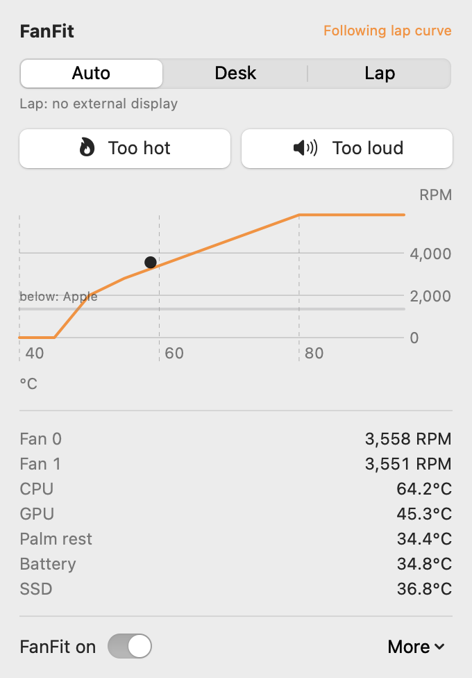

# FanFit 🌀 — Two buttons teach your Mac's fans

<p align="center">
  
</p>

<p align="center">
  <a href="https://github.com/jason301c/fanfit/actions/workflows/ci.yml"></a>
  
  
  
  <a href="LICENSE"></a>
</p>

FanFit is a menu bar fan controller for Apple Silicon MacBooks. You never edit a fan curve. You press **Too hot** or **Too loud**, and FanFit fits a temperature-to-RPM curve to your presses. It keeps one curve for the desk and one for the lap. It switches between them when an external display is plugged in or out.

**Small and local.** FanFit has a 450-line root daemon and a SwiftUI menu bar app. It has no network access, no account and no telemetry. Apple's own fan control takes over whenever FanFit exits, is paused or sees 98°C.

[Install](#install) · [How it works](#how-it-works) · [Safety](#safety) · [Development](#development)

## Install

You need an Apple Silicon Mac with macOS 14 or later and Xcode or the Command Line Tools.

```bash
git clone https://github.com/jason301c/fanfit.git
cd fanfit
./scripts/install.sh
```

The installer does these steps:

1. Builds the app and the daemon from source.
2. Installs `FanFit.app` in `~/Applications` and starts it at login.
3. Asks for your password, then installs the root daemon as `/usr/local/libexec/fanfitd`.
4. Stops and disables ThermalForge's daemon if it is installed, because two fan controllers fight.

To remove FanFit and hand the fans back to Apple, run `./scripts/uninstall.sh`.

## Quick start

1. Click the fan icon in the menu bar.
2. Leave the position on **Auto**. An external display means **Desk** and no external display means **Lap**. A position you pick by hand lasts until a display is plugged in or out.
3. Use your Mac as usual. When it feels too hot or sounds too loud, press the matching button.

Each press shows how the curve changed, for example `Lap curve at 72°C: 2,400 → 3,200 RPM`. To remove a press, choose **More → Undo last press**. To start the curve for the current position again, choose **More → Reset**.

## How it works

- **`fanfitd`** runs as root under launchd. Once a second it reads the SMC, looks up the curve and sets the fans. It also writes `/var/run/fanfit/status.json`.
- **`FanFit.app`** runs as you. It shows the readings, takes the button presses, fits the curves and writes `/Users/Shared/FanFit/control.json`. The daemon validates every value in that file.
- **The curve input** is the hottest CPU or GPU sensor, smoothed. Where the curve sits below the fans' minimum speed, Apple's controller runs the fans. On most Macs that means silence at low temperatures.

### Fitting the curve

Each press records the temperature and fan speed at that moment, and becomes a bound on the curve at that temperature:

| Press | Bound |
| --- | --- |
| Too hot | At least 30% faster, at least 700 RPM faster, and at least 2,000 RPM |
| Too loud | No faster than 20% slower minus 100 RPM |
| Too loud while Apple runs the fans | FanFit takes over at that slower speed |

Presses less than 15 seconds apart count as one stronger press. Each one steps on from the previous target, because the fans have not caught up yet.

The fitter changes the default curve as little as it can while meeting the bounds. It solves a small convex problem over non-decreasing curves between 0 RPM and the fans' maximum:

```
minimise  λ·|d|² + μ·|D¹d|² + Σ wᵢ · violationᵢ²
```

- `d` is the change from the default curve. `D¹` is its first difference, which fades a press out over about 7°C on each side. A press at 53°C leaves 40°C and 80°C alone.
- A press counts only while the curve breaks its bound.
- A press loses half its weight every 21 days, so newer presses win conflicts.
- Projected gradient descent (FISTA) finds the optimum. The projection is pool-adjacent-violators, then a clamp.

### Default curves

| °C | 45 | 50 | 55 | 60 | 65 | 70 | 75 | 80 | 85 | 90 |
| --- | --- | --- | --- | --- | --- | --- | --- | --- | --- | --- |
| Lap | Apple | 2,000 | 2,800 | 3,400 | 4,000 | 4,600 | 5,200 | max | max | max |
| Desk | Apple | Apple | Apple | 1,800 | 2,400 | 3,000 | 3,700 | 4,400 | 5,100 | max |

"Apple" means Apple's controller runs the fans, which usually keeps them off. Once FanFit runs the fans, it keeps them at their minimum for 60 seconds after the curve drops below it before it hands back. The curve input rises quickly with the temperature and falls slowly, so a short CPU burst does not make the fans speed up and slow down.

The code is in [`Sources/FanFitCore/Curve.swift`](Sources/FanFitCore/Curve.swift), and the tests are in [`Tests/FanFitCoreTests`](Tests/FanFitCoreTests).

### SMC keys

| Key | Meaning |
| --- | --- |
| `F0md`, `F1md` | Fan mode on M5: 0 is Apple, 1 is manual. M1 to M4 use `F0Md` and need `Ftst=1` first. |
| `F0Tg`, `F0Ac`, `F0Mn`, `F0Mx` | Target, actual, minimum and maximum RPM, as floats |
| `Tp*`, `TCMb`, `TCHP` | CPU temperatures |
| `Tg*` | GPU temperatures |
| `Ts0P` | Palm rest temperature |
| `TB*T` | Battery temperatures |

To print the readings on your Mac without root, run `.build/release/fanfitd --probe`.

## Safety

Apple's controller runs the fans in these cases:

- A CPU or GPU sensor reaches 98°C. FanFit takes back control once the chip cools to 90°C.
- The daemon exits for any reason, including `SIGTERM` from launchd. On start, it also clears any manual mode another tool left behind.
- You turn FanFit off in the menu.
- The control file is missing or invalid.

Fan speed rises by at most 500 RPM a second and falls by at most 150 RPM a second. FanFit never sets a fan below its minimum or above its maximum speed.

FanFit writes to the SMC through an undocumented interface. Use it at your own risk.

## Development

```bash
swift build
swift test
.build/debug/FanFit --snapshot docs/panel.png   # render the panel to a PNG
```

To test daemon changes, run `./scripts/install.sh` again. It replaces the daemon and the app in place.

## Credits

[ThermalForge](https://github.com/ProducerGuy/ThermalForge) (MIT) documented the M5 mode key `F%dmd` and the M1 to M4 `Ftst` unlock.
